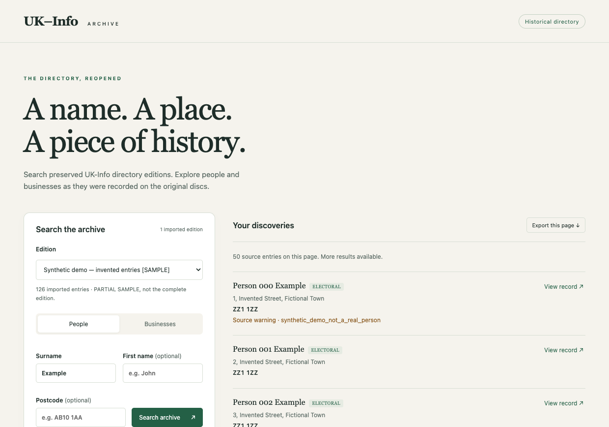

# UK-Info Archive

Search historical UK-Info directories without the original Windows software.
Explore people and businesses across five verified disc editions from 1998–2005,
with a web interface, an Electron desktop preview and a documented Python reader.

**[Search the archive](https://ukinfo.6153112.xyz)** ·
**[Documentation](docs/README.md)** ·
**[Supported editions](docs/editions.md)** ·
**[Contributing](CONTRIBUTING.md)**

## Choose your starting point

| Use | Start here | What you need |
| --- | --- | --- |
| Search online | [Public archive](https://ukinfo.6153112.xyz) | A browser; no login or import |
| Use a local desktop archive | [Desktop setup](docs/desktop-setup.md) and [builds](docs/desktop-releases.md) | Supported source media; macOS or Linux x86-64 |
| Host your own instance | [Production deployment](docs/production.md) and [hosting](docs/hosting.md) | Go service, PostgreSQL 18 and imported source media |
| Read or export original files | [Python quick start](docs/reader-quick-start.md) | Python 3.10+ and extracted source files |
| Investigate another edition | [Edition support guide](docs/adding-editions.md) | Source identity, format evidence and validation |

**Preview status:** the hosted service is public. Desktop candidates remain
[draft releases](https://github.com/abedegno/ukinfo-reader/releases); there is no
published desktop download yet. Native builds cover macOS Apple Silicon, macOS Intel
and Linux x86-64. Windows desktop and Linux ARM are not supported; the Python reader
is tested on Windows, macOS and Linux.

## Search and research

- Search people or businesses across editions; each result identifies its source.
- Combine names with postcodes, streets, towns, localities, counties and premises.
  Names accept a trailing `*`; postcode searches accept districts, sectors and full codes.
- Page through results, inspect readable records, compare co-listed entries at an address,
  and export the current page as original JSON Lines or readable CSV.
- Group identical listings and choose name, publication or distance ordering with the
  optional research index. Grouping does not establish that records describe the same person.
- Add optional ONSPD coordinates for nearby searches and approximate postcode maps.
- Keep saved searches, research lists, notes and citations locally in your browser or
  desktop profile. These are not stored in the hosted directory database.

The desktop wizard imports supported ISO/7z files or extracted folders, verifies the
edition and offers sample or complete imports. No directory records are bundled; an
invented demo is available for trying the app. See [the search guide](docs/search-app.md)
for feature requirements and limits. Broad national grouping/sorts can time out;
contains and fuzzy name matching are not implemented.

## Supported editions and source media

Support applies to these exact distributions. Matching product names alone do not
establish compatibility; use [edition identification and fingerprints](docs/editions.md).

| Edition | Cover disc | Source entries | Internet Archive |
| --- | --- | ---: | --- |
| UK-Info Disk SE | PC Format 78 · January 1998 | 27,983,545 | [PC Format 78](https://archive.org/details/pc-format-78) |
| UK-Info Disk SE 4.0 | PC Format 94 · April 1999 | 46,355,850 | [PC Format 94b](https://archive.org/details/pcf-94b-apr-1999-uk-info) |
| UK-Info 2003 SE · residential + business | DPCS0104DVD | 59,886,841 | [Supplied-disc fingerprints](docs/formats/2003-se.md) |
| UK-Info 2004 SE · residential | PC Plus 218 · July 2004 | 63,373,974 | [PC Plus 218 DVD](https://archive.org/details/pcp-218-dvd) |
| UK-Info Disk V10.5 SE · residential + business | PC Format 175 · June 2005 | 51,350,897 | [PC Format 175 DVDs](https://archive.org/details/pcf-175-dvd-1-06-05.7z) |

**248,951,107 source occurrences** across the five validated editions. These are not distinct
people. The public archive’s edition selector lists imports that are ready to search;
operators can also check the [live catalogue](https://ukinfo.6153112.xyz/api/datasets).
Dates above identify cover discs, not verified electoral-roll reference dates.
The supplied 2004 SE media has no separate business listings.

Select the matching file inside each Internet Archive item:

- **1998:** `PC_FORMAT_78.iso`.
- **1999:** `PCF 94b apr 1999 UK-INFO.iso`; the item also contains another ISO.
- **2004:** `PCP218_DVD.iso`.
- **2005:** `PCF175DVD2_06_05.7z`. UK-Info is on **DVD 2**, despite `dvd-1` in the item URL.

All five supported editions have complete validation reports. Known source defects and
uncertain field meanings are documented in the [validation overview](docs/validation-overview.md)
and [format references](FORMAT.md). Other editions, Standard and Pro releases need
separate investigation and validation.

## How it works

The **Python reader** decodes original files and streams verified imports. The
**Go service** searches an indexed **PostgreSQL 18** catalogue and embeds the web UI.
The **Electron app** runs the same service and a private local PostgreSQL instance.
Search requests do not run Python; the original Windows executables are never run.

Desktop packages include their runtimes. Archive data normally lives in the OS
application-data folder, independently of the executable. Physical database backups
require a matching OS, CPU architecture and PostgreSQL major version; use logical
transfers or re-import for other platforms. See [archive management](docs/catalogue-management.md).

For hosting, the four-edition base catalogue measured **38.26 GiB**; the fully indexed
development database measured **86.40 GiB** before WAL, backups and recovery headroom.
See [storage measurements and deployment guidance](docs/hosting.md). Optional indexes
and postcode coordinates are additional to the base catalogue.

## Contribute or report a problem

See [CONTRIBUTING.md](CONTRIBUTING.md) for Python, Go and desktop development checks.
CI uses invented fixtures and downloads no original directory databases.
[Open an issue](https://github.com/abedegno/ukinfo-reader/issues/new/choose) with a
reproduction using invented examples. For desktop faults, use **Help → Export diagnostics…**,
review the JSON, then attach it; [diagnostic contents](docs/diagnostics.md) are documented.
Report vulnerabilities using the [security policy](SECURITY.md).

Do not upload directory records, source images, proprietary binaries, research backups
or credentials to issues or pull requests. The repository contains reader code,
format documentation, aggregate validation evidence and synthetic tests.

## License and historical interpretation

New code and documentation use the [MIT license](LICENSE). It grants no rights to the
original UK-Info software or directory data; Internet Archive availability does not
change those rights. Bundled runtimes retain their own notices.

This is a historical directory for research and genealogy. Source entries can be
incomplete or inaccurate; shared addresses do not establish kinship, and the reader
does not establish birth dates or family relationships. UK-Info and magazine names
identify the historical products. This project is independent of their publishers.
